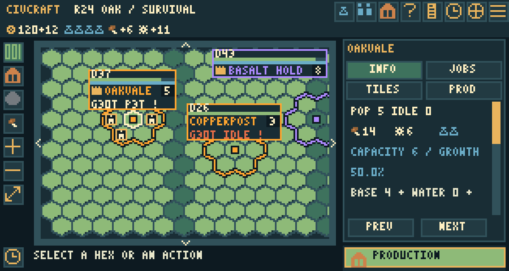

# Founders V4: choose the first city

User-requested extension after M2. New campaigns use `balance4` (Founders V4),
which inherits Landwork V3's Builders, capacity, economy and active victories.
Earlier profiles and saved worlds retain their setup, size and rules.

The publisher's [Civ VI first-turn guide](https://store.steampowered.com/news/posts/?appids=289070&enddate=1489683975&feed=steam_community_announcements)
identifies the standard starting units as a Settler and a Warrior, with the
Settler founding the player's chosen first city. CivCraft now uses one Settler
and one Stone Guard for every human and AI. No player city, borders, Scout or
Builder is granted automatically. Independent villages remain separate actors.

The starting Settler is free and does not increment trained-Settler prices.
Move it if desired, retain movement, and choose FOUND CAPITAL on legal land.
The first city founded is the original capital; subsequent cities do not replace
that designation. Founding uses CivCraft's current population-two city rules.
A cityless start survives save/load. Conquest cannot be awarded while a rival
still has a source from which to establish its first capital. Starting regions
retain their village and wilderness buffers. The AI selects a nearby observed
site, founds through the same action, staffs it and selects production in that
founding turn. Council formation can recheck its first electorate after founding
without repeating round effects or rewriting an ongoing election.

## City banners

Population appears in a separate badge next to the city name. A crown marks an
original capital; D is defense strength. Green and blue bars show city health
and walls. Owned cities show growth and production forecasts: G for turns to
growth, -P for starvation loss, P for build completion, REPEAT for an active
civilian project, WAIT when it cannot run, IDLE when production needs a choice,
and PAUSE for deliberate idle. `!` indicates a positive growth surplus slowed
by Settlement Capacity.

Banner clicks select the city. Names truncate and indicators simplify on small
viewports; nearby banners separate where space permits. Remembered cities use
last-observed public data and do not expose private queues or growth. Forecasts
are read-only and reuse a single yield calculation. The Codex explains the
indicators under CITY MAP BANNERS.

## New map dimensions

| Preset | Earlier profiles | Founders V4 |
|---|---|---|
| Compact | 24 × 16 | 32 × 22 |
| Standard | 40 × 26 | 56 × 36 |
| Large | 56 × 36 | 72 × 46 |
| Huge | 72 × 46 | 96 × 60 |
| Vast | 96 × 60 | 120 × 76 |

Dimensions are selected at generation and saved, never changed on load. The
new scale is identified as `founders-v1`. These are not performance guarantees;
large-world native latency remains part of the existing release validation work.

## Builder interaction repairs

Saved work, including a safety-paused queue, does not block the normal end-turn
control. Its escort is handled with it. Skipping one turn retains saved work;
manual movement replaces the group's work intention. An eligible current tile
has a direct WHEAT FIELD HERE / QUARRY HERE / LUMBER CAMP HERE action, followed
by the same cost/yield confirmation. Exhausted movement can queue work for a
later turn. A city center cannot be improved; the inspector explains this.

The roadmap also records the user's requested human Builder auto mode,
city-founding suggestions and gold tile purchases as subsequent work. The
current AI Builder planner and manual task queues are not a human auto mode.

## Delivery evidence and handover

[Founders validation record](validation/founders-v4-validation.json) identifies
the tested gameplay revision, native runtime, source/installed sessions, parity
checks and regression limitations. Native CraftOS-PC evidence is separate from
physical Minecraft monitor/rednet validation. The banner image above is a
source-rendered UI fixture. Expanded-map late-game performance remains unmeasured.

Delivery and review are tracked in [issue #70](https://github.com/fpbcraft/cc-scripts/issues/70)
and [PR #68](https://github.com/fpbcraft/cc-scripts/pull/68), stacked on M2 #65.
The new orchestrator owns integration and any unresolved validation follow-up.
This delivery does not resume balance studies or implement M3, Builder auto mode,
settlement suggestions or gold tile purchases.
